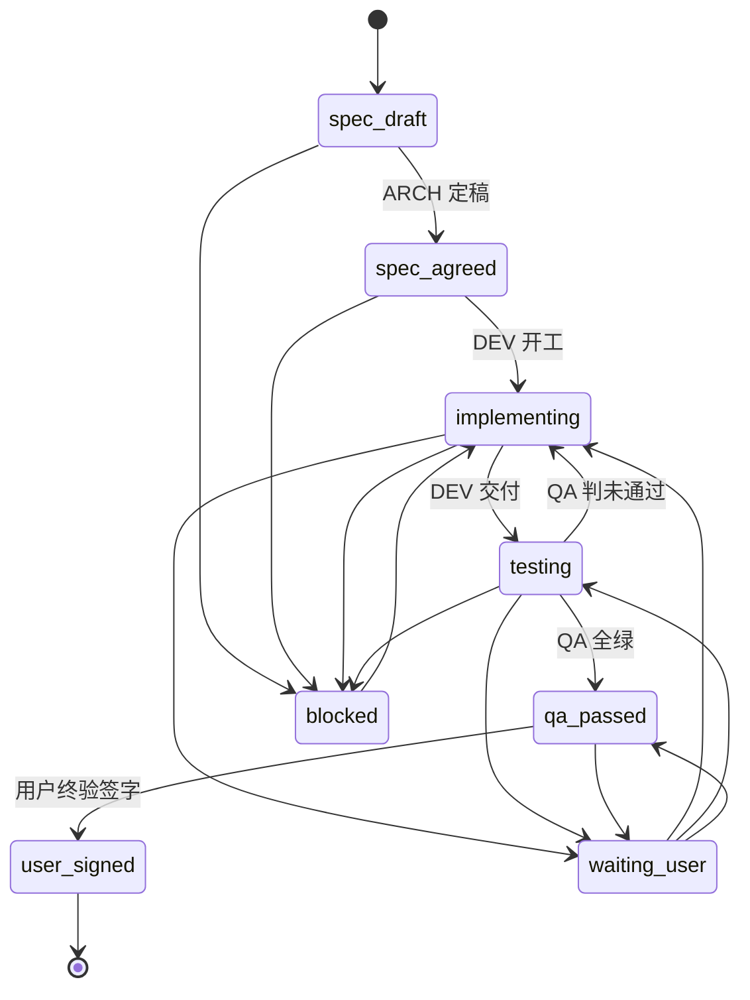

# omp 三人行脚手架（Three Amigos for omp）

面向终端多 Agent 隔离协作的脚手架体系。参考经典软件工程的**敏捷三人行**
（Three Amigos：ARCH / 系统架构、DEV / 开发、QA / 对抗测试）协作理念，
把「角色分工 + 契约先行 + 对抗验收」落到 omp 的实际运行机制上。

> 当前版本：**v0.2.0**

---

## 设计哲学

### 一、物理写隔离，能力全开

不剥夺 omp 的任何底层工具与执行能力 —— LSP、DAP、终端执行、浏览器、
子 Agent 全部保留。只在**写入落盘的那一刻**按角色拒绝越权路径。

隔离由两层构成，缺一不可：

| 层 | 位置 | 作用 |
|---|---|---|
| 进程内 hook | `.omp/hooks/pre/trio-guard.ts` | 实时拦截，在写入发生前阻断 |
| 提交兜底 | `.git/hooks/pre-commit` | 提交前复核暂存区，堵住绕过 hook 的路径 |

两层共用同一份策略真值源：`.omp/trio/policy.txt`。

**hook 是权威闸门**：越权文件在写之前就被拒，落不了盘。
pre-commit 是第二道，防的是「hook 漏判」与「人类误提交」——它依赖
`TRIO_ROLE` 环境变量，而环境变量可被调用方剥离（见「已知边界」）。

### 二、契约独立于实现

形式化契约（接口签名 + Given-When-Then + 极值边界）由 ARCH 发布，
测试由 QA 独立编写。开发**严禁**修改测试用例来掩盖 Bug；
QA 发现缺陷必须产出**最小报错复现脚本** + 缺陷文档。

这条约束不是靠提示词自觉，而是靠目录白名单硬隔离。

### 三、机械门禁优先于纪律

- 越权写入 → hook 当场拒绝
- 越权提交 → pre-commit 拒绝
- 报告造假（SKIP 计入 PASS、总判定与逐条不一致）→ 校验器拒绝提交
- 越权 push / tag → pre-push 拒绝（qa / arch 无发布权；dev 须 QA 全绿且看板达标）

四条都有可执行的检查，不依赖「请大家自觉」。

---

## 目录结构

```
omp-trio-scaffold/
├── bin/
│   ├── init-agent.sh            把脚手架注入目标项目
│   ├── start-agent.sh           以指定角色启动 omp
│   ├── trio-install.sh          把四个入口软链到本机 PATH
│   ├── trio-tmux.sh             把终端分成三块，各跑一个角色
│   ├── trio-check-report.mjs    验收报告机械校验器
│   └── trio-selftest.sh         一键自测门禁是否生效
├── profiles/                    角色简报（出厂源）
│   ├── arch.rules.md            ARCH：系统架构师 / 技术仲裁者
│   ├── dev.rules.md             DEV：高级软件开发工程师
│   └── test.rules.md            QA：对抗性质检与边界测试专家
├── templates/                   任务产物模板（出厂源）
│   ├── board.template.md        任务看板（状态机 + AC 进度 + 阻塞 + 决策）
│   ├── spec.template.md         技术契约（接口签名 + AC + 极值）
│   ├── release.template.md      交付说明（含验收清单）
│   ├── report.template.md       验收报告（四值结论域）
│   ├── bug.template.md          缺陷 / 契约缺口
│   ├── verdict.template.md      ARCH 裁决记录
│   ├── pre-commit               提交门禁脚本
│   └── pre-push                 推送 / 发布门禁脚本（ADR-0001）
├── .omp/                        脚手架自身的运行时副本
│   ├── trio/{arch,dev,test}.rules.md + policy.txt
│   ├── hooks/pre/trio-guard.ts  进程内写门禁
│   └── extensions/trio-session-name.ts  会话名自动设为角色
├── tests/
│   ├── trio-policy.test.mjs     门禁策略回归测试
│   ├── trio-check-report.test.mjs  报告校验器回归测试
│   ├── trio-guard.test.mjs      hook 运行时集成测试（不依赖模型）
│   └── trio-pre-push.test.mjs   发布门禁回归测试（角色 / 报告 / 看板）
├── docs/
│   ├── RUNBOOK.md               运行手册：单终端 / 三终端 / tmux / 排错
│   └── architecture/            跨任务 ADR（ARCH 独占）
├── README.md
├── .gitignore
└── .gitattributes
```

### 目标项目中的落地形态

`bin/init-agent.sh` 会在目标项目里创建：

```
<项目>/
├── .omp/
│   ├── trio/
│   │   ├── {arch,dev,test}.rules.md   角色简报
│   │   ├── policy.txt                 写策略真值源
│   │   └── templates/                 任务产物模板
│   ├── hooks/pre/trio-guard.ts        进程内写门禁
│   └── extensions/trio-session-name.ts 会话名自动设为角色
├── .git/hooks/pre-commit              提交门禁
├── .git/hooks/pre-push                发布门禁（ADR-0001）
├── bin/trio-check-report.mjs          报告校验器
├── docs/
│   ├── task/                          任务产物聚合层（一个任务一个文件夹）
│   │   └── 2026-10-25-登录改造/
│   │       ├── board.md               看板（三方共写）
│   │       ├── arch-20261025-0900-spec.md
│   │       ├── dev-20261025-1500-release.md
│   │       └── qa-20261025-1510-report-登录覆盖.md
│   └── architecture/                  跨任务 ADR（ARCH 独占）
├── src/                               DEV 独占：业务实现
└── tests/                             QA 独占：测试与复现脚本
```

---

## 发布到本机（可选）

不想每次敲长路径，可以把四个入口软链到 PATH 目录：

```bash
bin/trio-install.sh                 # 默认装到 ~/.local/bin
bin/trio-install.sh --prefix DIR    # 自定义目录
bin/trio-install.sh --check         # 只检查当前状态，不修改
bin/trio-install.sh --uninstall     # 删除软链
```

发布的是**软链**而非副本，所以仓库更新后无需重新发布：

| 命令 | 实际执行 |
|---|---|
| `trio-init` | `bin/init-agent.sh` |
| `trio-start` | `bin/start-agent.sh` |
| `trio-tmux` | `bin/trio-tmux.sh` |
| `trio-selftest` | `bin/trio-selftest.sh` |

之后在任意目录：

```bash
cd ~/projects/some-app
trio-init                 # 注入脚手架
trio-selftest --fast      # 确认门禁生效
trio-start arch           # 开第一个角色
```

> 脚本用 `readlink -f` 解析自身真实路径，软链调用不会把仓库根算到软链所在目录的上级。
> `trio-selftest` 第 1 段有一条回归检查专门守住这个性质。

---

## 接入新项目

```bash
cd /path/to/omp-trio-scaffold
bin/init-agent.sh /path/to/your-project
```

| 参数 | 说明 |
|---|---|
| `<目标项目路径>` | 要初始化的项目目录，默认当前目录 |
| `--force` | 覆盖已存在的文件（默认**不覆盖**，只打印「跳过」） |

**前置条件**：目标目录必须已是 git 仓库（pre-commit 门禁依赖 git）。

---

## 启动三角色

**完整运行手册见 [`docs/RUNBOOK.md`](docs/RUNBOOK.md)**（含 tmux 按键、常见问题）。两种方式：

### 方式 A：单终端，一次一个角色

最常用。开一个终端，跑一条命令就是一个角色：

```bash
cd ~/projects/my-app
bin/start-agent.sh arch      # 系统架构师
```

退出 omp（`/quit` 或 `/exit`）后回到**同一个终端**的提示符，接着起下一个：

```bash
bin/start-agent.sh dev       # 开发
bin/start-agent.sh qa        # 对抗测试
```

要三个角色同时在线，就开三个终端，各自 `cd` 到同一项目目录跑一条。

`start-agent.sh` 在**当前终端前台**启动 `omp`——`exec` 替换的是脚本自身进程，
不是你的交互 shell，所以退出后终端不会关闭。不新开窗口、不后台化。它会：

1. 导出 `TRIO_ROLE` —— 门禁的身份来源（hook 与 pre-commit 共用）
2. 用 `--append-system-prompt` 注入对应角色简报
3. 以 `--model` 指定默认模型（见下节）

### 方式 B：tmux 单窗口三分屏

把当前终端切成三块，每块一个角色。一个 window、三个 pane——不是三个 window。

```bash
bin/trio-tmux.sh                      # 默认左中右（横屏）
bin/trio-tmux.sh --layout rows        # 上中下（竖屏）
bin/trio-tmux.sh --project ~/projects/my-app --session trio-app
bin/trio-tmux.sh --no-attach          # 只建会话，稍后 tmux attach
bin/trio-tmux.sh --force              # 会话已存在时重建
```

| 布局 | 排列 | 适合 |
|---|---|---|
| `cols`（默认） | 左 → 右：`ARCH` `DEV` `QA` | 宽屏 / 横向终端 |
| `rows` | 上 → 下：`ARCH` `DEV` `QA` | 竖屏 / 高窄终端 |

每个 pane 顶部有边框标题显示角色名，当前焦点 pane 的边框高亮。初始焦点在 `ARCH`。
pane 默认 `remain-on-exit failed`：omp 异常退出时保留 pane 以便读错误。

常用按键：`Ctrl-b` + 方向键切 pane，`Ctrl-b z` 放大当前 pane，`Ctrl-b d` 脱离会话。

> 三个 pane 共享同一项目目录与同一 git 工作树；隔离仍由写策略白名单保证。

### 模型：默认 `deepseek/deepseek-v4.1-flash`

三个角色默认都跑 `deepseek/deepseek-v4.1-flash`（commandcode provider）。
`start-agent.sh` 始终以 `--model <模型>` 启动，`TRIO_MODEL` 可覆盖：

| 操作 | 三个角色实际使用的模型 |
|---|---|
| `trio-start arch` | `deepseek/deepseek-v4.1-flash`（默认） |
| `TRIO_MODEL=claude-opus-5 trio-start arch` | `claude-opus-5` |
| `trio-tmux` | 三个 pane 都是默认 |
| `trio-tmux --model claude-sonnet-5` | 三个 pane 都是 `claude-sonnet-5` |
| 会话内 `/model` | 仅当前会话临时切换 |

默认值定义在 `bin/start-agent.sh` 的 `TRIO_DEFAULT_MODEL` 一处，改它即可换出厂默认。

> 默认值必须保留 `deepseek/` 这段前缀：裸写 `deepseek-v4.1-flash` 会精确命中
> opencode-go provider 下的同名模型，而不是这里要用的 commandcode 那条。

```bash
omp models                      # 列出所有可用模型
omp models find deepseek        # 按关键词搜索
```

> **别名**：`pm` 是 `arch` 的历史名称，`bin/start-agent.sh pm` 仍可用，
> 会打印一行提示后按 `arch` 启动。`TRIO_ROLE=pm` 同理。

---

## 任务工作流

### 一、建任务文件夹

```bash
mkdir -p docs/task/2026-10-25-登录改造
cp .omp/trio/templates/board.template.md docs/task/2026-10-25-登录改造/board.md
cp .omp/trio/templates/spec.template.md  docs/task/2026-10-25-登录改造/arch-20261025-0900-spec.md
```

### 二、产物命名规范

```
<角色>-<YYYYMMDD>-<HHMM>-<主题>.md
```

| 例子 | 说明 |
|---|---|
| `arch-20261025-0900-spec.md` | 契约 |
| `arch-20261025-1520-verdict-1.md` | 裁决记录 |
| `dev-20261025-1500-release.md` | 交付说明（含验收清单） |
| `qa-20261025-1510-report-登录覆盖.md` | 验收报告 |
| `qa-20261025-1600-bug-1.md` | 缺陷 / 契约缺口 |
| `board.md` | 看板（唯一无角色前缀的文件，三方共写） |

- 时间戳取**完整日期 + 时分**：任务跨天时纯 `HHMM` 会错序。
- 主题自由文本；**报告**的 topic 段必须以 `report` 开头（pre-commit 据此识别）。
- 同一分钟写入多份 → 追加 `-2`、`-3`。

### 三、状态机



| 状态 | 含义 | 唯一有权推进者 |
|---|---|---|
| `spec_draft` | 契约撰写中，AC 未定稿 | **ARCH** |
| `spec_agreed` | AC 定稿，DEV / QA 可开工 | **ARCH** |
| `implementing` | 实现进行中 | **DEV** |
| `testing` | 实现已交付，QA 验证中 | **QA** |
| `qa_passed` | 机械标准清零 | **QA** |
| `user_signed` | 用户终验签字，任务关闭 | **用户** |
| `blocked` | 技术/依赖/契约缺口，待 ARCH 或外部条件 | 提出方 |
| `waiting_user` | 待用户决策或终验签字，**同轮 MUST NOT 继续实施** | 提出方 |

> **通过 = 机械清零 + 用户终验签字**，缺一不可。任何角色的「没问题」汇报不作数。

---

## 写策略

策略唯一真值源：`.omp/trio/policy.txt`。语法：

```
allow <role> <glob>       该角色允许写入该路径
deny  <role> <glob>       该角色禁止写入该路径
```

- `<role>`：`arch` / `dev` / `qa` / `*`（所有角色）
- 别名：`pm` 是 `arch` 的历史名称，消费方在匹配前自动归一化
- 判定：**deny 优先**；deny 未命中但 allow 命中则允许；两者都没命中则**拒绝**（fail-closed）
- 路径相对于项目根目录；`*` 匹配任意字符（含 `/`）

### 角色矩阵

| 路径 | ARCH | DEV | QA |
|---|:---:|:---:|:---:|
| `docs/task/*/arch-*.md` | ✅ 写 | ❌ | ❌ |
| `docs/architecture/**` | ✅ 写 | ❌ | ❌ |
| `docs/task/*/dev-*.md` | ❌ | ✅ 写 | ❌ |
| `docs/task/*/qa-*.md` | ❌ | ❌ | ✅ 写 |
| `src/**` | ❌ | ✅ 写 | ❌ |
| `tests/**` | ❌ | ❌ | ✅ 写 |
| `CHANGELOG.md` / `pyproject.toml` / `setup.cfg` / `setup.py` | ❌ | ✅ 写 | ❌ |
| `docs/task/*/board.md` | ✅ | ✅ | ✅ |
| 公共维护区 | ✅ | ✅ | ✅ |

公共维护区（三方均可写）：`README.md`、`docs/RUNBOOK.md`、`requirements*.txt`、
`uv.lock`、`poetry.lock`、`pytest.ini`、`.pytest.ini`、`ruff.toml`、
`.ruff.toml`、`pyrightconfig.json`、`.gitignore`、`.gitattributes`、
`.github/workflows/*`。

版本号与 `CHANGELOG.md` 属**发布链**，已收窄为 DEV 独占（ADR-0001）——
qa / arch 越写会被 pre-commit / trio-guard 拒绝。

门禁自身（`.omp/hooks/**`、`.omp/trio/policy.txt`、`.git/hooks/pre-commit`、
`bin/**`）对任何角色都是 deny —— 否则被约束者可以自行解除限制。

### 发布与 push

发布权归 DEV 独占（`docs/architecture/ADR-0001-发布权与push管控.md`）：

- **qa / arch**：`git push` / `git tag` 被 pre-push hook 机械拒绝；人工推送用 `unset TRIO_ROLE`。
- **dev**：push 前置 = QA 报告全绿 + 看板 `qa_passed` / `user_signed`；`qa_passed` 后须等用户终验签字。
- **未设置 `TRIO_ROLE`**：放行（人工逃生舱）。

完整矩阵见 [`docs/RUNBOOK.md` §4.5](docs/RUNBOOK.md)。

### 为什么任务文件夹用文件名前缀而不是子目录

一个任务的全部痕迹平铺在同一目录，`ls` 一次就能按时间读出
spec → release → report → bug 的完整链路。改成 `arch/`、`dev/`、`qa/` 三个子目录，
等于把刚合并的视图重新拆开。代价是隔离契约从「目录」降级为「文件名前缀」——
门禁管得到写入，管不到内容语义，这与原来的信任等级一致。

---

## 验收报告校验

报告是「任务通过」的唯一凭据，因此**提交时强制机械校验**：

```bash
bun bin/trio-check-report.mjs docs/task/<slug>/qa-20261025-1510-report-x.md
```

| 规则 | 内容 |
|---|---|
| T1 | 文件名 `qa-<YYYYMMDD>-<HHMM>-report-<主题>.md` |
| T2 | 表头三字段（运行环境含版本号 / 基线 commit / 运行时间与文件名同源）各一次 |
| T3 | 唯一 4 列结果表 `用例\|位置\|结论\|说明` + 分隔行 + 至少一行 |
| T4 | 用例主键非空且不重复 |
| T5 | 通过 → 位置填 `—`；其余必填（文件:行 / 函数） |
| T6 | 结论四值：`通过` / `半通过` / `未通过` / `SKIP` |
| T7 | 未通过/半通过 → 说明含 期望/实际/复现；SKIP → 跳过原因/解除条件 |
| T8 | 汇总非表格；总判定与逐行结论机械推导一致；SKIP 单列计账 |
| T9 | 仅 Markdown，禁伴随 `.json/.csv/.xlsx/.parquet` |

`templates/pre-commit` 在暂存区出现 `docs/task/*/qa-*-report-*.md` 时自动调用它，
不合规直接拒绝提交；`bun` 缺失时 fail-closed。

**半通过 / 未通过的判定口径**：

| 档位 | 判据 |
|---|---|
| `通过` | 该 AC 的全部子项通过 |
| `半通过` | 主路径全过，边界/异常/非功能至少一项未过 |
| `未通过` | 至少一项主路径未过 |

---

## 多任务并行与 worktree

同一任务内的三个角色**共享同一个工作树** —— QA 必须能立刻看到 DEV 写的 `src/`。
跨任务并行时，每个任务一个 worktree：

```bash
git worktree add ../wt-task-b -b feat/task-b
```

- 角色身份靠 `TRIO_ROLE`，与所在工作树无关，因此每个 worktree 里跑
  `bin/start-agent.sh <role>` 即生效。
- `templates/pre-commit` 用 `git rev-parse --show-toplevel` 定位项目根，
  linked worktree 下也正确（早期用 `$GIT_DIR/..` 会落到 `.git/worktrees` 上）。
- 任务目录随分支走，不同任务的分支互不触碰同一个文件 → 合并零冲突。

---

## 四条铁律

1. **契约先行**：ARCH 写完 AC 之前，DEV / QA 只能读、不能猜。
2. **测试独立**：DEV 不改 `tests/`，QA 不改 `src/`；契约有错走 `contract-gap` 请 ARCH 裁决。
3. **只报不修**：QA 发现缺陷只报告 —— 越权改 `src/` 会污染缺陷真相。
4. **commit 纪律**：多角色共享工作树，commit MUST 显式 pathspec。
   **严禁** `git add -A` / `git add .` —— 会盲扫吞掉他人未完成的 WIP。

**3 轮熔断**：「QA 判未通过 → DEV 修 → QA 复测仍未通过」计 1 轮。
连续 3 轮未全绿必须停手，在看板记 `blocked` 并写明四项：
失败条目 / 已试修法 / 根因分歧 / 建议。

---

## 自测

### 一键自测

```bash
bin/trio-selftest.sh /path/to/your-project
```

八段验证：

| 阶段 | 验证内容 |
|---|---|
| 1/8 | 安装完整性：hook、策略、校验器、会话名扩展、pre-commit、模板、软链解析 |
| 2/8 | 准备测试夹具 |
| 3/8 | 三套单元测试：策略契约、报告契约、hook 运行时 |
| 4/8 | pre-commit 角色门禁：越权拒绝、合规放行、无角色放行 |
| 5/8 | pre-commit 报告硬门禁：不合规报告被拒 |
| 6/8 | **真实 omp**：write/edit/bash 三通道 |
| 7/8 | 角色白名单：QA 写 `src/` 被拦 |
| 8/8 | 清理夹具 |

跳过真实 omp 调用：

```bash
bin/trio-selftest.sh --fast /path/to/your-project
```

### 手动快速自测

```bash
cd /path/to/your-project

# 1. write 通道：DEV 写 tests/ 应被拦，写 src/ 应放行
TRIO_ROLE=dev omp -p '用 write 工具创建 tests/x.txt，然后再创建 src/ok.txt。分别报告成功或被拦。'

# 2. bash 通道：写意图被拦，只读放行
TRIO_ROLE=dev omp -p '先用 bash 执行: echo bad > tests/x.txt。再执行: ls tests/。分别报告结果。'

# 3. pre-commit 兜底
git add tests/ && TRIO_ROLE=dev git commit -m probe   # 期望拒绝
git add tests/ && git commit -m probe                 # 期望放行
```

### 单元测试

```bash
bun tests/trio-policy.test.mjs        # 门禁策略契约（111 项）
bun tests/trio-check-report.test.mjs  # 报告校验器契约（34 项）
bun tests/trio-guard.test.mjs         # hook 运行时集成，不依赖模型（38 项）
```

---

## 自举：能用本项目治理本项目吗

**只能部分自举，不能三方齐上。** 写策略是按「业务项目」形状设计的（`src/` + `tests/` + `docs/task/`），
而本仓库的「实现」是 `bin/`、`templates/`、`profiles/`、`.omp/trio/` —— 恰好都在保护区内。

在本仓库内以角色身份启动时，实测可写矩阵：

| 路径 | arch | dev | qa |
|---|:---:|:---:|:---:|
| `docs/task/*/arch-*.md`、`docs/architecture/**` | ✓ | ✗ | ✗ |
| `docs/task/*/dev-*.md`、`src/**` | ✗ | ✓ | ✗ |
| `docs/task/*/qa-*.md`、`tests/**` | ✗ | ✗ | ✓ |
| `README.md`、`CHANGELOG.md`、`docs/task/*/board.md` | ✓ | ✓ | ✓ |
| `templates/**`、`profiles/**`、`.omp/trio/*.rules.md` | ✗ | ✗ | ✗ |
| `bin/**`、`.omp/hooks/**`、`.omp/trio/policy.txt` | ✗ | ✗ | ✗ |

原因是结构性的：**本仓库的实现就是门禁组件本身**。允许任一角色改写 `policy.txt`、
`trio-guard.ts` 或 `trio-check-report.mjs`，等于让它自行解锁；放宽这一条就等于放弃
「机械门禁优先于纪律」这条设计前提。此外本仓库没有 `src/`，DEV 的实现通道在这里是空的。

**推荐姿势**：

| 层 | 谁来做 | 工具 |
|---|---|---|
| 本仓库的 `bin/`、`templates/`、`profiles/` | 人类（角色之外） | `trio-selftest` 当验收 |
| 本仓库的设计与 ADR | ARCH 会话 | `docs/task/*/arch-*.md` |
| 本仓库的回归测试 | QA 会话 | `tests/trio-*.test.mjs` |
| 被治理的业务项目 | 三角色齐上 | 全套门禁 |

它的价值在**被治理的项目**上，而不在治理自己。硬要自举也可以给本仓库单独加一份
meta 策略，但必须继续锁死 `policy.txt`、hook、报告校验器与 `bin/init-agent.sh`，
剩下的可写面只有 `templates/`、`profiles/`、`bin/start-agent.sh` —— 收益不抵复杂度。

---

## 已知边界

- **hook 拦不住 `eval` 里的全部写法**：只匹配代码中的文件路径字面量，
  运行时拼接出来的路径无法静态识别。
- **hook 拦不住「路径藏在文件里」的写操作**：`patch -p1 < fix.patch`、
  `python script.py`（脚本内部自行写盘）等形式，命令文本里没有目标路径。
  这类操作仍会被 pre-commit 在提交时兜住。
- **hook 拦不住绕过 omp 的写入**：直接手改文件两者都拦不住 —— 终端工具的固有边界。
- **pre-commit 看不到「是谁改的」**，角色判定完全依赖 `TRIO_ROLE` 环境变量。
- **文件名前缀是隔离契约的一部分**：一个角色可以给文件起误导性主题名，
  门禁管不到内容语义。
- **`tests/trio-*.test.mjs` 归 QA 所有**：QA 可以修改门禁契约测试本身。
  pre-commit 只能保证 DEV 不改 `tests/`。
- **pre-commit 的兜底可被剥离环境变量绕过**：agent 在 bash 里执行
  `env -u TRIO_ROLE git commit` 时，git 进程拿不到角色，pre-commit 按「人工提交」放行。
  所以真正的第一道闸是 hook——越权文件根本写不进去，也就无从提交。
- **会话名由扩展写入，且只在无标题时生效**：`.omp/extensions/trio-session-name.ts`
  缺失时不会报错，只是会话名保持 omp 默认；你 `/rename` 过的会话不会被改回角色名。
- **tmux pane 标题是展示层**：边框上的 `ARCH`/`DEV`/`QA` 不影响门禁，
  真正决定权限的只有 `TRIO_ROLE`。
