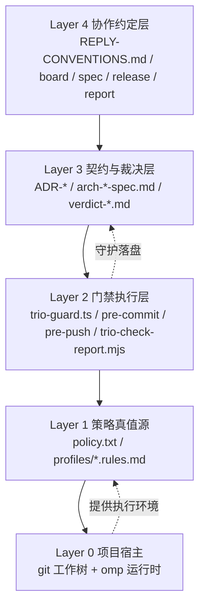

# ADR-0000 架构总览（omp 三人行脚手架）

- 状态：accepted
- 日期：2026-10-26
- 关联：ADR-0001 … ADR-0005（本 ADR 为其聚合入口，不替代任一条）

## 上下文

omp-trio-scaffold 是一个**协作门禁脚手架**，而非业务应用：它把「角色分工 +
契约先行 + 对抗验收」落到 omp 的运行机制上。此前架构决策分散在 5 条 ADR
与 RUNBOOK/README 中，无单一入口视图，新读者无法在 5 分钟内回答：

- 系统分几层、边界在哪？
- 哪些是稳定内核、哪些可替换？
- 依赖方向是什么？
- 已有决策的推翻条件汇总在哪？

本 ADR 提供该入口视图；具体决策细节仍以对应 ADR 为准（本文件不复制正文）。

## 系统定位与边界

- **产物形态**：可注入任意项目目录的脚手架（`bin/init-agent.sh` 注入），
  注入后目标项目获得 `.omp/`、`profiles/`、`templates/`、`bin/` 四类资产。
- **不负责**：业务代码、业务测试、业务发布流水线；只提供协作与门禁机制。
- **运行时宿主**：omp（终端多 Agent），三角色进程共享同一 git 工作树，
  隔离靠写策略白名单，不靠目录隔离。

## 分层与模块边界

**依赖方向**：上层依赖下层；下层不得引用上层。Layer 2 读取 Layer 1 的策略；
Layer 3/4 的产物由 Layer 2 守护落盘；Layer 0 提供执行环境。

**禁止**：Layer 1 反向依赖 Layer 2（策略 DSL 不得含执行逻辑）；
Layer 3 的契约不得直接修改 Layer 0 的业务代码（ARCH 硬性禁令）。

## 稳定内核 vs 可替换边界

| 类别 | 路径 / 组件 | 稳定性 | 替换成本 |
|---|---|---|---|
| 稳定内核 | `.omp/trio/policy.txt` 语法与判定语义 | 高 | 需 ADR + 两层同步 |
| 稳定内核 | 角色集合 `arch / dev / qa`（含 `pm` 别名） | 高 | 需 ADR + 全仓同步 |
| 稳定内核 | 四值结论域（pass / fail / skip / blocked） | 高 | 需 ADR |
| 可替换边界 | 默认模型 `deepseek/deepseek-v4.1-flash` | 中 | 改 `bin/start-agent.sh` 常量 |
| 可替换边界 | 门禁实现语言（TS → 其它） | 中 | 保持策略语义一致即可 |
| 可替换边界 | 任务目录命名形态 `TASK-<NNN>-<YYYY-MM-DD>-<slug>` | 中 | 需 ADR-0005 修订 |
| 可替换边界 | 报告/契约模板字段 | 低 | 改 templates + 校验器同步 |

## 技术栈与运行时

- Shell：bash（门禁脚本、init/start/install/selftest/tmux）
- 门禁实现：TypeScript（`.omp/hooks/pre/trio-guard.ts`，omp 进程内 hook）
- 校验器：Node.js ESM（`bin/trio-check-report.mjs`）
- 测试：Node.js `node --test`（`tests/*.test.mjs`）
- 版本控制：git（pre-commit / pre-push 两道兜底）
- 模型宿主：omp（`deepseek/deepseek-v4.1-flash` 默认）

## ADR 索引（跨任务决策）

| 编号 | 标题 | 状态 | 关联任务 | 核心决策一句话 |
|---|---|---|---|---|
| ADR-0001 | 三角色对 push 与本机发布的权限管控 | accepted | TASK-001 | 发布链五类动作（push/tag/bump/publish/截版）全部机械边界化；发布权归 dev |
| ADR-0002 | 门禁效力层级、自举豁免与发布证据绑定 | accepted | TASK-002 | 三层效力模型（尽力而为/权威/逃生舱）+ 自举豁免白名单 + 证据绑定对象 |
| ADR-0003 | 门禁自举任务的临时写通道 | accepted | TASK-002 | 用户人工落盘 + pre-commit 兜底，根信任全程不可触 |
| ADR-0004 | 三角色回复规范与任务接力机制 | accepted | TASK-003 | 单一共享 `REPLY-CONVENTIONS.md` + 接力提示词块 + 挂起清单 |
| ADR-0005 | 任务命名、流程标记与接力提示词 | accepted | TASK-003 | `TASK-<NNN>-<YYYY-MM-DD>-<slug>` + 四阶段处置流程 + 七段提示词 |
| ADR-0006 | 下游项目对齐策略（C+A） | accepted | —（跨任务） | 结构对齐为主 + 人工落盘逃生舱；标准=本项目结构；存量迁移 dry-run；升级分类覆盖 |

## 非功能基线

- **写隔离**：hook 实时拦截 + pre-commit 提交前复核，缺一不可（ADR-0001/0002）。
- **契约独立**：ARCH 发布契约，QA 独立编写测试，dev 不得改测试掩盖缺陷。
- **机械门禁优先**：越权写入/提交/报告造假/越权 push 全部可执行检查，不依赖自觉。
- **幂等与审计**：所有门禁决策可追溯到 policy.txt + ADR + git commit。
- **兼容性**：`pm` 别名向 `arch` 归一化，旧环境变量不必改。

## 推翻条件总表

| 决策 | 推翻条件（摘要） |
|---|---|
| ADR-0001 | 发布权需要下放给 qa/arch，或引入 maintainer 角色（当前已否决） |
| ADR-0002 | 三层效力模型无法覆盖新的绕过路径，或自举豁免被滥用 |
| ADR-0003 | policy DSL 增加 deny-例外/到期语义，使临时通道可被策略表达 |
| ADR-0004 | 回复约定被证明无法机械校验，或接力信息双写成本过高 |
| ADR-0005 | 目录命名/轮次口径在规模化任务下产生冲突 |

## 与其它文档的关系

- `README.md`：设计哲学与目录结构（面向首次读者）。
- `docs/RUNBOOK.md`：运行操作手册（面向已初始化用户）。
- `docs/REPLY-CONVENTIONS.md`：回复格式与接力约定（面向三角色会话）。
- 本 ADR：架构决策聚合入口；具体决策以 ADR-0001..0005 为准。

## 决策

选定 **聚合入口 ADR** 模式：不新建第二套架构文档，把现有 5 条 ADR 与
运行手册的关系显式化，新读者从 ADR-0000 出发即可定位全部决策。

## 后果

- 正面：架构决策有单一入口；推翻条件可聚合审阅；新 ADR 可在索引表追加一行。
- 负面：需在每次新增 ADR 时同步更新本文件索引表（轻微维护成本）。
- 推翻条件：ADR 数量超过 10 条或分层结构发生根本变化时，应把本文件拆分为
  `docs/architecture/README.md` + 独立架构图文件。