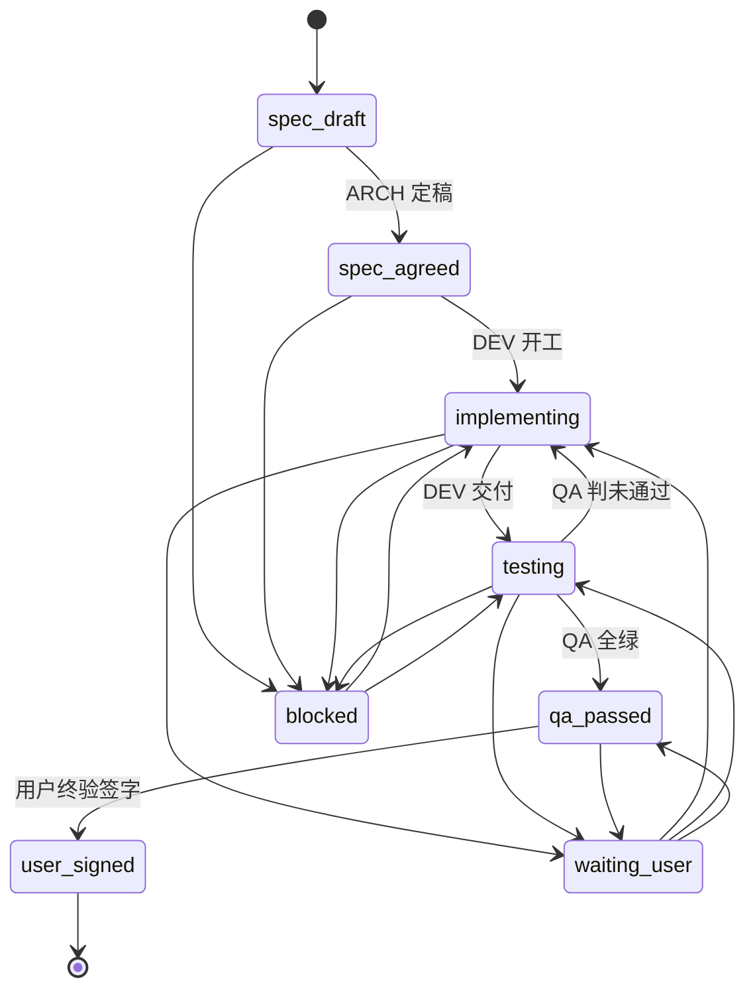

# 任务看板：<任务标题>

<!--
落位：docs/task/<YYYY-MM-DD-事项>/board.md —— 一个任务文件夹一份，三方共写。

用法：新建任务时从本模板复制到任务文件夹，然后填「标识」段。
本文件是任务状态的**单一权威**：任何角色想知道「现在到哪一步」，只看这里。

设计约束：
  - 不设「产物索引」段 —— 文件名已编码 时间/角色/主题，`ls` 就是索引，
    再列一遍必然漂移。
  - 不设「历史任务」段 —— 一个文件夹一个任务，历史就是 `docs/task/` 目录列表。
  - 只写文件名编码不了的信息：状态、AC 进度、阻塞、决策理由。
-->

## 1. 标识

| 字段 | 值 |
|---|---|
| Task ID | `TASK-000` |
| 任务目录 | `docs/task/2026-10-25-登录改造/` |
| 工作树 / 分支 | `../wt-login` / `feat/login` |
| 起始日期 | `2026-10-25` |
| qa_report | `docs/task/2026-10-25-登录改造/qa-20261025-1510-report-登录覆盖.md`；exempt 任务填 `—` |
| release_gate | `strict`（默认）或 `exempt(<reason>)`；reason 仅 `[A-Za-z0-9_-]+` |

<!--
qa_report：本任务 QA 报告路径。pre-push 会校验「报告在本任务目录、
通过校验器、基线 commit 是待推提交的祖先」，且看板状态为
qa_passed / user_signed。
release_gate：缺省等同上表的 strict；自举/维护类任务（确实产不出 QA
报告）才可写 exempt(<reason>)，且本看板「决策记录」段必须引用对应
裁决编号（V-N 或 *-verdict-N.md）。pre-push 放行时会输出审计行。
-->

## 2. 状态

| 字段 | 值 |
|---|---|
| 当前状态 | `spec_draft` |
| 最后推进人 | `ARCH` |
| 最后更新 | `2026-10-25 15:10` |

### 处置流程

| 阶段 | 状态 | 轮次 | 熔断计数（实现轮 N/3） | 根因分类 |
|---|---|---|---|---|
| ① ARCH 设计（契约定稿） | done | spec v2 | — | — |
| ② DEV 开发 | 进行中 | 第 1 轮 | `0/3` | — |
| ③ QA 测试 | 待办 | — | `0/3` | — |
| ④ 闭环（user_signed + 挂起清单清零） | 待办 | — | — | — |

迭代日志：
- 第 1 轮 15:10：ARCH 定稿 v2 → ② DEV 开发

②⇄③ 回环即迭代（不设独立「迭代」阶段行）；轮次口径 = 3 轮熔断定义
（「QA 判未通过 → DEV 修 → QA 复测」计 1 轮）。

**熔断计数只计「实现缺陷轮」**（ADR-0013 §2.3）：QA 未通过 → DEV 修 → 复测未通过 = 1 轮。
契约缺陷 / 用例错 / 环境轮**不计数**，但 MUST 在 1 轮内转 `contract-gap` / verdict / 用例修正，
转不动即 `blocked`。根因分类取 `[根因:实现]` / `[根因:契约]` / `[根因:用例]` / `[根因:环境]`
（QA 报告机检，见 `bin/trio-check-report.mjs` T11）。

状态推进权（只有该角色能把当前状态推进到下一态）：

| 状态 | 含义 | 有权推进者 |
|---|---|---|
| `spec_draft` | 契约撰写中，AC 未定稿 | **ARCH** |
| `spec_agreed` | AC 定稿，DEV / QA 可开工 | **ARCH** |
| `implementing` | 实现进行中 | **DEV** |
| `testing` | 实现已交付，QA 验证中 | **QA** |
| `qa_passed` | 机械标准清零（校验器通过 + 无未通过/半通过） | **QA** |
| `user_signed` | 用户终验签字，任务关闭 | **用户** |
| `blocked` | 技术/依赖/契约缺口，待 ARCH 或外部条件 | 提出方 |
| `waiting_user` | 待用户决策或终验签字，**同轮 MUST NOT 继续实施** | 提出方 |

> 「通过」= 机械清零 **+** 用户终验签字，缺一不可。任何角色的「没问题」汇报不作数。

## 3. 验收准则进度

> 只记状态，不复制准则正文 —— 正文以 `arch-*-spec.md` 为准。

| AC | 契约定稿 | 实现 | 验证 | 状态 |
|---|---|---|---|---|
| AC-1 | `☐` | `☐` | `☐` | `待定稿` |
| AC-2 | `☐` | `☐` | `☐` | `待定稿` |

## 4. 阻塞与待裁决

| 编号 | 类型 | 描述 | 提出 | 待谁 | 起始时间 |
|---|---|---|---|---|---|
| B-1 | `blocked` / `waiting_user` | `<一句话>` | `DEV` | `ARCH` | `15:10` |

> 同一任务连续修复 3 轮仍未全绿 → 必须停手，在此记 `blocked` 并写下四项：
> 失败条目 / 已试修法 / 根因分歧 / 建议。

## 5. 决策记录

> 契约为什么改、改成什么、落在哪。没有这一段，spec 版本号变了没人知道原因。

| 时间 | 议题 | 裁决 | 落点 |
|---|---|---|---|
| `15:20` | `<分歧点>` | `<结论>` | `arch-20261025-1520-verdict-1.md` / `ADR-0003` |

## 6. 交接备注

<!--
交接备注用「下一步任务分配」书写：每步 = 承接方行 + text 围栏完整提示词块
（七段骨架【任务】【必读】【指令】【交付】【纪律】【突出】【完成】），board 为权威。
-->

<当前角色停在哪里、下一步该谁做什么。一两句话，禁止长篇。>

## 7. 挂起清单（SKIP/待解除）

| 条目 | 解除条件 | 触发者 | 解除后动作 |
|---|---|---|---|
| AC-12 通道回收核验 | user_signed | QA | bun tests/trio-gate-contract.test.mjs |

`user_signed` + 挂起清单清零 = 真闭环；解除条件成熟 → 触发者集中补测一轮。
